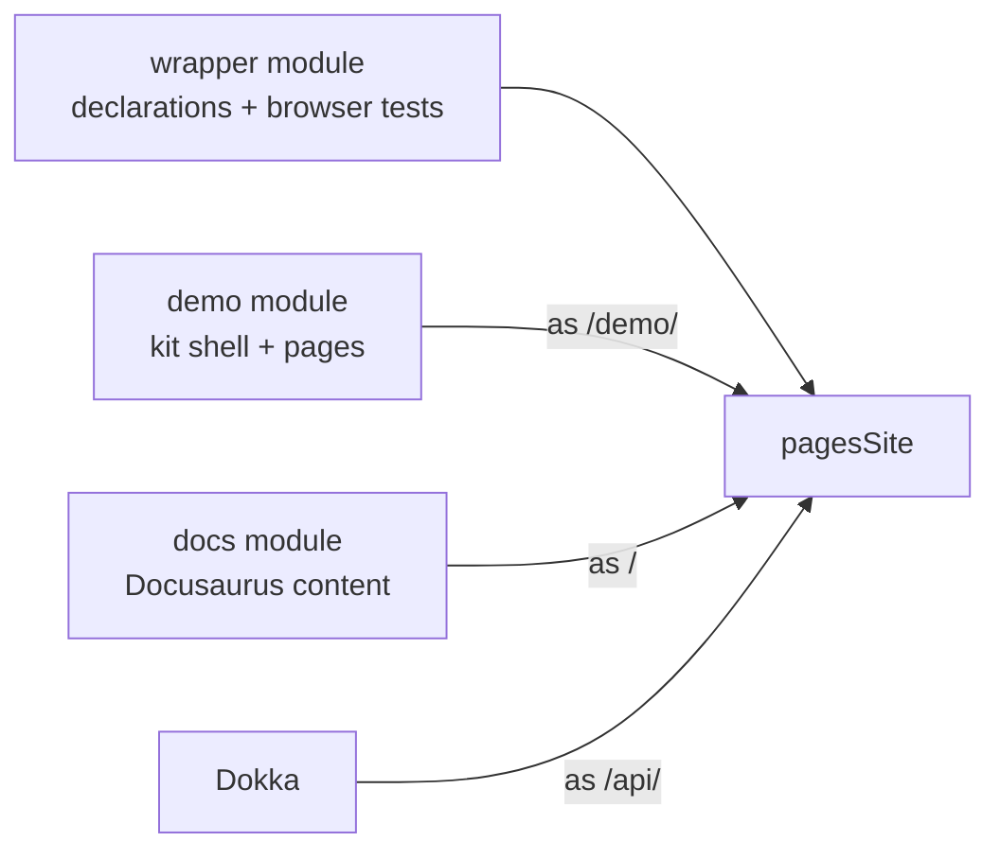

# Getting started

## Requirements

- JDK 21 or newer; the Gradle wrapper is checked in (9.4.1).
- Node and npm are downloaded and driven by the Kotlin Gradle plugin — there is no `npm install` step
  to remember, and `kotlin.js.yarn=false` keeps npm as the package manager.
- Chromium is downloaded by Playwright the first time a browser test runs.

## Build, test, publish

```bash
./gradlew build                    # compile, Detekt, browser tests
./gradlew :ktjs-sortable:jsBrowserTest
./gradlew :demo:e2eTest            # Playwright against the bundled demo page
./gradlew :docs:docusaurusBuild    # the documentation site
./gradlew pagesSite                # documentation at /, demo at /demo/, Dokka at /api/
```

`build` does not run the demo's end-to-end suite or assemble the Pages site: both need a browser and
are part of CI as separate steps.



`pagesSite` is the only task that puts the three products side by side; `build` stops at compiling,
testing and the wrapper's own browser suite.

## Develop

```bash
./gradlew :docs:docusaurusStart              # dev server for this site
./gradlew :demo:jsBrowserDevelopmentRun      # dev server for the demo page
```

Docusaurus watches the site directory, so Markdown edits reload; Kotlin changes need
`./gradlew :docs:docusaurusSite` first, because the site imports the compiled module.

### When the demo dev server fails

`jsBrowserDevelopmentRun` runs webpack as an external process. When that process exits with a
non-zero code, the Kotlin Gradle plugin can only report `Error occurred. See log for details.`:
whatever webpack printed was forwarded as progress lines, and the default console erases the progress
area when the task ends. Rerun with a plain console to keep them:

```bash
./gradlew :demo:jsBrowserDevelopmentRun --console=plain
```

A port that is already taken is not one of those reasons — the dev server walks from 8080 to 8081 and
onwards, so a dev server left running does not make the task fail. If the plain console stays empty
too, run the command Gradle runs and read its stderr directly; the generated package is under
`build/js/packages/<module>-demo`:

```bash
cd build/js/packages/ktjs-sortable-demo
node ../../node_modules/webpack/bin/webpack.js serve --config webpack.config.js
```

For any suspicious startup failure — this task or a browser test — try a fresh daemon before anything
else: `./gradlew --stop`, then rerun. A long-lived daemon carries stale state from the previous build
(handles of node children it spawned, an output directory it still considers locked).

## Depend on the wrapper

```kotlin
kotlin {
    js {
        browser()
        binaries.library()
    }
    sourceSets {
        jsMain.dependencies {
            implementation("io.github.shijianjs:ktjs-sortable:1.15.7-kt.1")
        }
    }
}
```

The published version is `{npm version}-kt.{revision}`, so `1.15.7-kt.1` is `sortablejs` 1.15.7 with
the first wrapper revision. The npm package itself is declared by the module, so a consumer adds
nothing else to `package.json`.

## The first list

```kotlin
val container = document.getElementById(ElementId("board")) as HTMLElement

val list = createSortable(container) {
    animation = 150
    dataIdAttr = "data-id"          // what toArray() reports
    ghostClass = "sortable-ghost"
    onEnd = { event ->
        println("${event.oldIndex} -> ${event.newIndex}")
    }
}

// Items are container children; upstream's default draggable is ">*", so nothing has to be marked up.
list.toArray()
```

`createSortable` is `Sortable.create(el, options)` with a builder lambda; the options object holds only
the fields the lambda sets, so every other field keeps upstream's default.

## Where things live

| Path | Contents |
| --- | --- |
| `package.json` | the only place npm versions are declared (Dependabot maintains it) |
| `wrapper-revisions.properties` | per-module `-kt.N` revision |
| `ktjs-sortable/src/jsMain/kotlin` | the wrapper declarations |
| `ktjs-sortable/src/jsTest/kotlin` | browser tests for them |
| `demo/src/jsMain` | the demo page and its Kotlin entry point |
| `docs/src/jsMain/kotlin` | the site configuration and sidebar |
| `docs/src/jsMain/resources` | Markdown pages, MDX landing page, CSS, translations |
| `docs/development/coverage.md` | what is wrapped, what is excluded and why |

## The lock file

npm dependencies are resolved once for the whole workspace and pinned in
`kotlin-js-store/package-lock.json`. After adding or upgrading an npm dependency — or changing a
module's version — regenerate it:

```bash
./gradlew kotlinUpgradePackageLock
```

CI verifies the committed file, so a forgotten regeneration fails the build rather than drifting.
