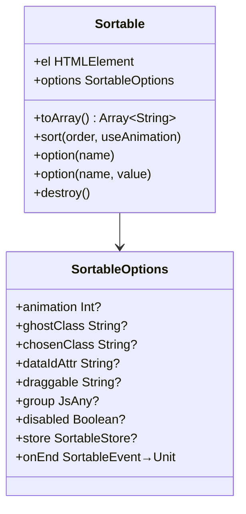
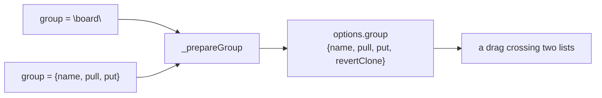
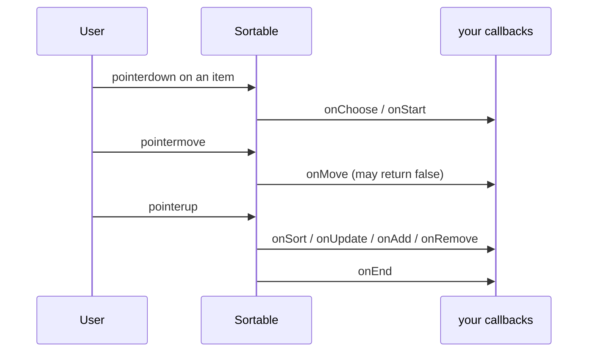

# Usage

## Creating a list

`createSortable` takes the element whose children become draggable, plus a builder for upstream's
options. Only the fields the lambda sets are written; the rest stay `undefined` so upstream's defaults
apply:

```kotlin
val list = createSortable(container) {
    animation = 150                  // milliseconds, 0 for none
    ghostClass = "sortable-ghost"    // class on the drop placeholder
    chosenClass = "sortable-chosen"  // class on the element being dragged
    handle = ".handle"               // optional: only this part starts a drag
    disabled = false
    sort = true
    dataIdAttr = "data-id"
}
```

`Sortable(el, options)` is available too — it is the same constructor, kept for code that wants to
hold the options object itself. The options object is live: `list.options.animation = 200` applies
immediately, and `list.option("animation", 200.asJsAny())` goes through upstream's option setter, which
also re-runs the per-option hooks.



## Groups

`group` is a string or an object. Upstream normalises whatever you pass into an object with
`{name, pull, put, revertClone}`, so reading it back after construction yields the object form — a
fact the tests pin down.

```kotlin
// One shared group: both lists can exchange items.
val source = createSortable(sourceEl) { group = "board".asJsAny() }
val target = createSortable(targetEl) { group = "board".asJsAny() }

// Or the object form, where the rules differ per list.
createSortable(targetEl) {
    group = sortableGroup("board") {
        pull = "clone".asJsAny()
        put = false.asJsAny()
        revertClone = true
    }
}
```



`pull` / `put` / `checkPull` / `checkPut` accept a boolean, `"clone"`, an array of group names or a
predicate — four shapes, so the wrapper keeps them `JsAny` and gives you `asJsAny()` widenings for the
two common ones.

## Events

Every callback receives one typed object. Upstream fills the fields per event, so they are nullable:

| Callback | When it fires | Fields that matter |
| --- | --- | --- |
| `onChoose`, `onUnchoose` | a drag starts or is abandoned on an item | `item`, `oldIndex` |
| `onStart` | the drag really begins | `item`, `oldIndex`, `from` |
| `onMove` | the pointer moves over a candidate | `to`, `from`, `dragged`, `related`, `willInsertAfter` |
| `onSort` | items changed order inside one list | `oldIndex`, `newIndex`, `from` |
| `onAdd`, `onRemove` | an item moved between two lists | `from`, `to`, `oldIndex`, `newIndex` |
| `onUpdate` | an item changed position inside one list | `oldIndex`, `newIndex` |
| `onEnd` | the drag ends, whatever the outcome | `item`, `oldIndex`, `newIndex` |
| `onClone` | a group pulled a copy | `clone`, `item` |
| `onFilter` | `filter` rejected the item | `item` |

`onMove` is the one that can veto: it receives `SortableMoveEvent` plus the DOM event, and returning
`false` cancels the move. The wrapper types the return as `JsAny?` — upstream also accepts a
`Promise<Boolean>`, which Kotlin cannot express in one signature.

```kotlin
createSortable(container) {
    onMove = { move, _ ->
        // Only allow drops into the same list.
        if (move.to !== move.from) false.asJsAny() else null
    }
    onEnd = { event -> event.item?.setAttribute("data-moved", "1") }
}
```



## Order in and out

`toArray()` reads the current order from the DOM — ids come from `options.dataIdAttr`, or from a
generated id when the attribute is missing. `sort(order, useAnimation)` re-orders the children to the
array you pass; ids it does not know are ignored, so a partial order is not an error.

```kotlin
val order = list.toArray()                       // ["alpha", "bravo", "charlie"]
list.sort(order.reversedArray(), true)           // animate to the new order
```

`sort` moves DOM nodes synchronously but does **not** fire the callbacks; if a page keeps its own
state in an `onEnd` handler, call the same refresh after `sort` as the drag path does.

`save()` hands the instance to `options.store.set` — the persistence hook — and `store.get` supplies
the order back to upstream:

```kotlin
val list = createSortable(container) {
    store = unsafeJso<SortableStore> {
        get = { _ -> storage.getItem("order")?.split(",")?.toTypedArray() ?: emptyArray() }
        set = { sortable -> storage.setItem("order", sortable.toArray().joinToString(",")) }
    }
}
```

## The statics

The constructor also carries state, which is why it lives on the companion:

| Member | Meaning |
| --- | --- |
| `Sortable.create(el, options)` | same as `createSortable`, without the builder |
| `Sortable.get(el)` | the instance bound to that element, or `null` |
| `Sortable.mount(plugins)` | plugin constructors, for the `complete` build |
| `Sortable.active`, `.dragged`, `.ghost`, `.clone` | the drag in progress, the dragged node, the placeholder, the pulled copy |
| `Sortable.version` | upstream's version string |
| `Sortable.utils` | the DOM helpers below |

`utils` is upstream's own helper bag, declared as `SortableUtils`: `on` / `off` / `css` / `find` /
`is` / `closest` / `toggleClass` / `index` / `clone` / `extend` / `nextTick` / `cancelNextTick` /
`getChild` / `expando`. The wrapper exposes it because plugins and pages reach for it, not because the
wrapper needs it.

## Where the wrapper stops

The wrapper declares types; the drag algorithm, the ghost, the fallback path and the group rules stay
in `sortablejs`. Two consequences worth knowing:

- **Plugins are not wrapped.** The npm package's `plugins/` directory is documentation only; the
  plugin code ships pre-mounted in `modular/sortable.complete.esm.js`, a second entry point this module
  does not import. `Sortable.mount` is declared so a consumer that loads the complete build can still
  mount, but the wrapper's own dependency is the default entry (`Sortable.min.js` /
  `modular/sortable.esm.js`). See the coverage document for the reasons per plugin.
- **No `.d.ts` upstream.** The declarations were written from `src/Sortable.js`, then cross-checked
  field by field against `@types/sortablejs` 1.15.9. Where the two disagree the source wins.
