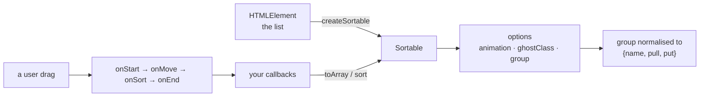

# ktjs-sortable

A Kotlin/JS wrapper for [`sortablejs`](https://github.com/SortableJS/Sortable): the `Sortable` class,
the options it reads, the events it fires and the static registry it keeps — declared from upstream's
own source, with no dynamic calls.

```kotlin
val list = createSortable(container) {
    animation = 150
    ghostClass = "sortable-ghost"
    dataIdAttr = "data-id"
    onEnd = { _ -> status.set(list.toArray().joinToString(", ")) }
}

list.toArray()                                        // ["alpha", "bravo", "charlie"]
list.sort(arrayOf("charlie", "alpha", "bravo"))       // and the page follows
```

## What the module contains

| Kotlin entry point | Upstream | What it gives you |
| --- | --- | --- |
| `Sortable`, `Sortable.Companion` | the default export | the instance API and the constructor's statics |
| `createSortable`, `sortableOptions` | `Sortable.create(el, options)` | the call a page normally needs |
| `SortableOptions` | `Options` | 30+ fields, every one nullable so upstream's defaults apply |
| `SortableEvent`, `SortableMoveEvent` | the callback payloads | one typed object per event |
| `SortableGroupOptions`, `sortableGroup` | the `group` object form | who may pull from, and who may put into, a list |
| `SortableUtils` | `Sortable.utils` | the DOM helpers upstream exports |
| `Point`, `SortableStore` | `fallbackOffset`, `store` | the two small object shapes |



## Reading order

1. [Getting started](guide/getting-started.md) — the dependency, a build, the first list.
2. [Usage](guide/usage.md) — options, groups, events, order in and out, and the statics.
3. [Licensing](guide/licensing.md) — MIT on both sides, and what the wrapper deliberately leaves out.

The [demo](https://shijianjs.github.io/ktjs-sortable/demo/) is a running consumer of this module, and
the [API reference](https://shijianjs.github.io/ktjs-sortable/api/) is the Dokka output for every
declaration this module publishes.
