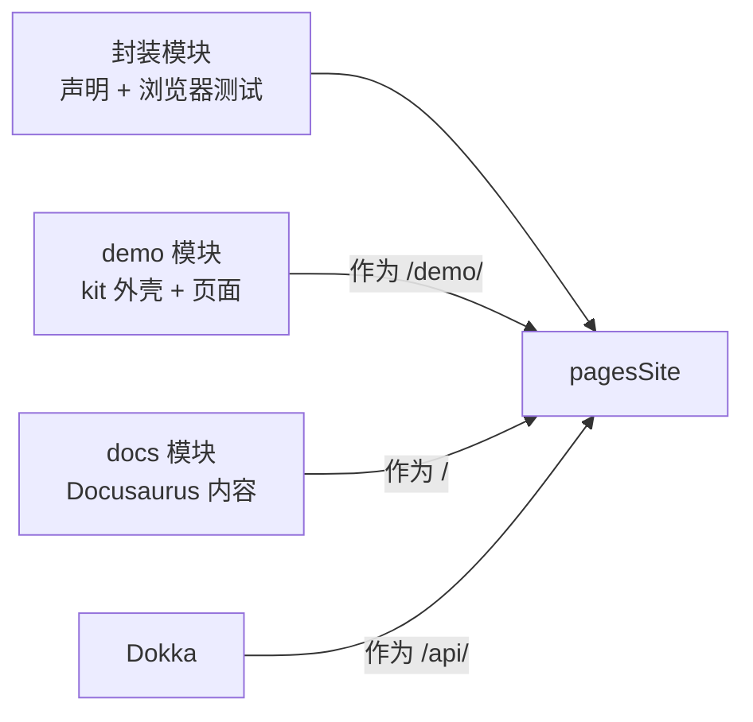

# 快速开始

## 环境要求

- JDK 21 或更新；Gradle wrapper 已随仓库提交（9.4.1）。
- Node 与 npm 由 Kotlin Gradle 插件下载并驱动——没有需要记住的 `npm install` 步骤，
  `kotlin.js.yarn=false` 让 npm 保持为包管理器。
- 第一次跑浏览器测试时，Playwright 会下载 Chromium。

## 构建、测试、发布

```bash
./gradlew build                    # 编译、Detekt、浏览器测试
./gradlew :ktjs-sortable:jsBrowserTest
./gradlew :demo:e2eTest            # 用 Playwright 跑打包后的 demo 页面
./gradlew :docs:docusaurusBuild    # 文档站
./gradlew pagesSite                # 文档在 /，demo 在 /demo/，Dokka 在 /api/
```

`build` 不跑 demo 的端到端套件，也不组装 Pages 站点：两者都需要浏览器，在 CI 里是独立步骤。



`pagesSite` 是唯一把三个产物并排放在一起的任务；`build` 止步于编译、测试和封装自己的浏览器套件。

## 开发

```bash
./gradlew :docs:docusaurusStart              # 本站的开发服务器
./gradlew :demo:jsBrowserDevelopmentRun      # demo 页面的开发服务器
```

Docusaurus 监听站点目录，改 Markdown 会热更新；改 Kotlin 要先
`./gradlew :docs:docusaurusSite`，因为站点引用的是编译后的模块。

### demo 开发服务器失败时

`jsBrowserDevelopmentRun` 把 webpack 当作外部进程跑。该进程以非零码退出时，Kotlin Gradle 插件只能报
`Error occurred. See log for details.`：webpack 的输出被当作进度行转发，而默认控制台在任务结束时
会擦掉进度区域。用 plain 控制台重跑把它们留住：

```bash
./gradlew :demo:jsBrowserDevelopmentRun --console=plain
```

端口被占用不属于这类原因——开发服务器会从 8080 往 8081 继续找，所以留着一个没关的开发服务器不会让
任务失败。若 plain 控制台依旧空白，直接跑 Gradle 跑的那条命令读它的 stderr；生成的包在
`build/js/packages/<module>-demo` 下：

```bash
cd build/js/packages/ktjs-sortable-demo
node ../../node_modules/webpack/bin/webpack.js serve --config webpack.config.js
```

任何可疑的启动失败——这个任务或浏览器测试——先换一个干净的守护进程：`./gradlew --stop` 再重跑。
长期存活的守护进程会带着上一轮构建的陈旧状态（它拉起的 node 子进程句柄、它仍认为被锁住的输出目录）。

## 依赖这个封装

```kotlin
kotlin {
    js {
        browser()
        binaries.library()
    }
    sourceSets {
        jsMain.dependencies {
            implementation("io.github.shijianjs:ktjs-sortable:1.15.7-kt.1")
        }
    }
}
```

发布版本是 `{npm 版本}-kt.{修订号}`，所以 `1.15.7-kt.1` 是 `sortablejs` 1.15.7 加上第一个封装修订。
npm 包本身由模块声明，使用方不必再往 `package.json` 里加任何东西。

## 第一个列表

```kotlin
val container = document.getElementById(ElementId("board")) as HTMLElement

val list = createSortable(container) {
    animation = 150
    dataIdAttr = "data-id"          // toArray() 读的就是它
    ghostClass = "sortable-ghost"
    onEnd = { event ->
        println("${event.oldIndex} -> ${event.newIndex}")
    }
}

// 条目就是容器的子元素；上游默认的 draggable 是 ">*"，所以不必再标任何东西。
list.toArray()
```

`createSortable` 就是 `Sortable.create(el, options)` 加一个构造器 lambda；选项对象里只有 lambda 设过的
字段，其余字段都保持上游默认值。

## 各部分在哪

| 路径 | 内容 |
| --- | --- |
| `package.json` | npm 版本只在这里声明（由 Dependabot 维护） |
| `wrapper-revisions.properties` | 每个模块的 `-kt.N` 修订号 |
| `ktjs-sortable/src/jsMain/kotlin` | 封装层的声明 |
| `ktjs-sortable/src/jsTest/kotlin` | 针对它们的浏览器测试 |
| `demo/src/jsMain` | demo 页面与它的 Kotlin 入口 |
| `docs/src/jsMain/kotlin` | 站点配置与侧边栏 |
| `docs/src/jsMain/resources` | Markdown 页面、MDX 首页、CSS、译文 |
| `docs/development/coverage.md` | 封装了什么、排除了什么、为什么 |

## 锁文件

npm 依赖在整个工作区只解析一次，钉在 `kotlin-js-store/package-lock.json`。新增或升级 npm 依赖——
或者改模块版本——之后重新生成：

```bash
./gradlew kotlinUpgradePackageLock
```

CI 会校验提交进去的这份文件，所以忘了重生会让构建失败，而不是悄悄漂移。
