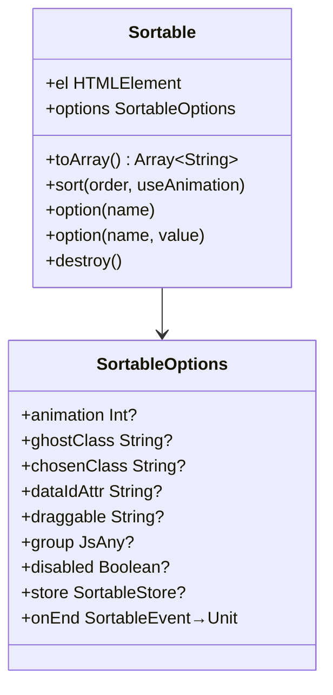
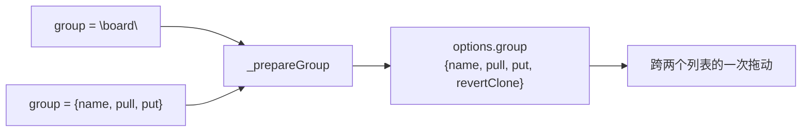
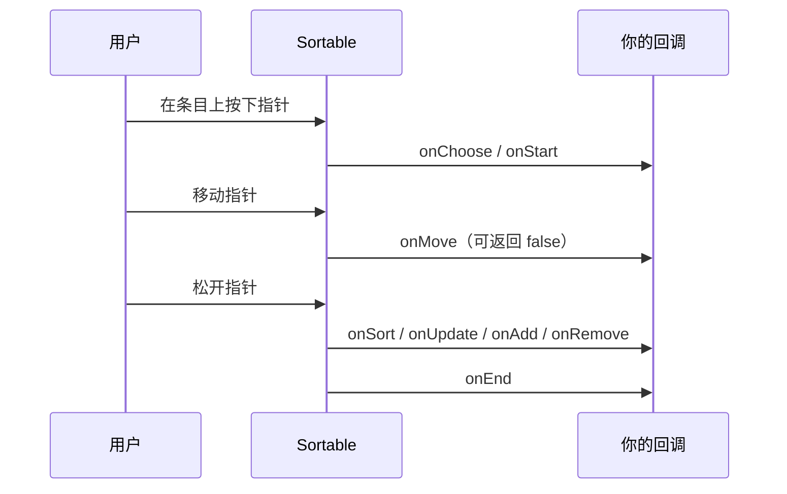

# 用法

## 建一个列表

`createSortable` 接的是「子元素会变成可拖动项」的那个元素，外加一个上游选项的构造器。只有 lambda
设过的字段会被写入，其余保持 `undefined`，让上游的默认值生效：

```kotlin
val list = createSortable(container) {
    animation = 150                  // 毫秒，0 表示不做动画
    ghostClass = "sortable-ghost"    // 落点占位元素上的 class
    chosenClass = "sortable-chosen"  // 正在拖的元素上的 class
    handle = ".handle"               // 可选：只有这部分能起拖
    disabled = false
    sort = true
    dataIdAttr = "data-id"
}
```

`Sortable(el, options)` 同样可用——同一个构造函数，留给想自己持有选项对象的那类代码。选项对象是活的：
`list.options.animation = 200` 立即生效，`list.option("animation", 200.asJsAny())` 走上游的选项 setter，
它还会重跑每个选项的钩子。



## 分组

`group` 可以是字符串，也可以是对象。上游会把你传进去的东西归一化成
`{name, pull, put, revertClone}` 对象，所以构造之后再读回来拿到的是对象形式——这一点测试专门钉住了。

```kotlin
// 一个共享分组：两个列表可以互换条目。
val source = createSortable(sourceEl) { group = "board".asJsAny() }
val target = createSortable(targetEl) { group = "board".asJsAny() }

// 或者对象形式，每个列表的规则不一样。
createSortable(targetEl) {
    group = sortableGroup("board") {
        pull = "clone".asJsAny()
        put = false.asJsAny()
        revertClone = true
    }
}
```



`pull` / `put` / `checkPull` / `checkPut` 接受布尔值、`"clone"`、分组名数组或谓词——四种形状，
所以封装层把它们留成 `JsAny`，并给两种最常见的提供 `asJsAny()` 扩宽。

## 事件

每个回调都收到一个带类型的对象。上游按事件填字段，所以它们都可空：

| 回调 | 何时触发 | 关键字段 |
| --- | --- | --- |
| `onChoose`、`onUnchoose` | 在某个条目上起拖，或放弃 | `item`、`oldIndex` |
| `onStart` | 拖动真正开始 | `item`、`oldIndex`、`from` |
| `onMove` | 指针在候选位置移动 | `to`、`from`、`dragged`、`related`、`willInsertAfter` |
| `onSort` | 单个列表内部顺序变了 | `oldIndex`、`newIndex`、`from` |
| `onAdd`、`onRemove` | 条目在两个列表之间移动 | `from`、`to`、`oldIndex`、`newIndex` |
| `onUpdate` | 条目在同一个列表内换了位置 | `oldIndex`、`newIndex` |
| `onEnd` | 拖动结束，不论结果 | `item`、`oldIndex`、`newIndex` |
| `onClone` | 分组取了一份拷贝 | `clone`、`item` |
| `onFilter` | `filter` 拒绝了该条目 | `item` |

`onMove` 是唯一能否决的：它收到 `SortableMoveEvent` 和 DOM 事件，返回 `false` 即取消这次移动。封装层把
返回类型写成 `JsAny?`——上游也接受 `Promise<Boolean>`，Kotlin 没法在一个签名里同时表达。

```kotlin
createSortable(container) {
    onMove = { move, _ ->
        // 只允许放回同一个列表。
        if (move.to !== move.from) false.asJsAny() else null
    }
    onEnd = { event -> event.item?.setAttribute("data-moved", "1") }
}
```



## 顺序的读与写

`toArray()` 从 DOM 读当前顺序——id 来自 `options.dataIdAttr`，缺这个属性时用生成 id。
`sort(order, useAnimation)` 按传入的数组重排子元素；它不认识的 id 会被忽略，所以传部分顺序不算错。

```kotlin
val order = list.toArray()                       // ["alpha", "bravo", "charlie"]
list.sort(order.reversedArray(), true)           // 带动画排到新顺序
```

`sort` 同步移动 DOM 节点，但**不触发**回调；如果页面在 `onEnd` 里维护自己的状态，`sort` 之后要像拖动
路径那样再刷新一次。

`save()` 把实例交给 `options.store.set`——持久化钩子——而 `store.get` 负责把顺序交回上游：

```kotlin
val list = createSortable(container) {
    store = unsafeJso<SortableStore> {
        get = { _ -> storage.getItem("order")?.split(",")?.toTypedArray() ?: emptyArray() }
        set = { sortable -> storage.setItem("order", sortable.toArray().joinToString(",")) }
    }
}
```

## 静态成员

构造函数本身也带状态，所以它们放在 companion 上：

| 成员 | 含义 |
| --- | --- |
| `Sortable.create(el, options)` | 同 `createSortable`，但不带构造器 |
| `Sortable.get(el)` | 绑在该元素上的实例，没有则 `null` |
| `Sortable.mount(plugins)` | 插件构造函数，给 `complete` 构建用 |
| `Sortable.active`、`.dragged`、`.ghost`、`.clone` | 进行中的拖动、被拖节点、占位元素、取出的拷贝 |
| `Sortable.version` | 上游版本字符串 |
| `Sortable.utils` | 下面那组 DOM 工具 |

`utils` 是上游自己的工具包，声明为 `SortableUtils`：`on` / `off` / `css` / `find` / `is` / `closest` /
`toggleClass` / `index` / `clone` / `extend` / `nextTick` / `cancelNextTick` / `getChild` / `expando`。
封装层把它暴露出来，是因为插件和页面会用到，而不是因为封装自己需要。

## 封装层到此为止

封装只声明类型；拖拽算法、ghost、降级路径和分组规则都留在 `sortablejs` 里。两个值得知道的后果：

- **插件没有封装。** npm 包里的 `plugins/` 目录只是文档；插件代码预装在
  `modular/sortable.complete.esm.js` 里，那是本模块不引用的另一个入口。`Sortable.mount` 声明了，
  这样用 complete 构建的使用方仍能挂载，但封装自己的依赖是默认入口（`Sortable.min.js` /
  `modular/sortable.esm.js`）。逐个插件的理由见覆盖文档。
- **上游没有 `.d.ts`。** 声明是按 `src/Sortable.js` 写的，再与 `@types/sortablejs` 1.15.9 逐字段对照。
  两者不一致时以源码为准。
