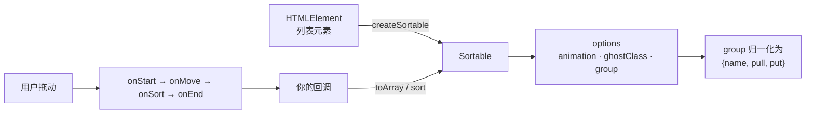

# ktjs-sortable

[`sortablejs`](https://github.com/SortableJS/Sortable) 的 Kotlin/JS 封装：`Sortable` 类、它读取的选项、
它触发的事件，以及它保存的静态注册表——全部按上游源码声明，不写 dynamic 调用。

```kotlin
val list = createSortable(container) {
    animation = 150
    ghostClass = "sortable-ghost"
    dataIdAttr = "data-id"
    onEnd = { _ -> status.set(list.toArray().joinToString(", ")) }
}

list.toArray()                                        // ["alpha", "bravo", "charlie"]
list.sort(arrayOf("charlie", "alpha", "bravo"))       // 页面跟着变
```

## 模块里有什么

| Kotlin 入口 | 上游 | 提供什么 |
| --- | --- | --- |
| `Sortable`、`Sortable.Companion` | 默认导出 | 实例 API 与构造函数上的静态成员 |
| `createSortable`、`sortableOptions` | `Sortable.create(el, options)` | 页面通常只需要这一个调用 |
| `SortableOptions` | `Options` | 30 多个字段，全部可空，因此上游默认值照旧生效 |
| `SortableEvent`、`SortableMoveEvent` | 回调载荷 | 每个事件一个带类型的对象 |
| `SortableGroupOptions`、`sortableGroup` | `group` 的对象形式 | 谁能从列表取、谁能往列表放 |
| `SortableUtils` | `Sortable.utils` | 上游导出的 DOM 工具 |
| `Point`、`SortableStore` | `fallbackOffset`、`store` | 两个小的对象形状 |



## 阅读顺序

1. [快速开始](guide/getting-started.md) —— 依赖坐标、一次构建、第一个列表。
2. [用法](guide/usage.md) —— 选项、分组、事件、顺序的读与写，以及静态成员。
3. [许可](guide/licensing.md) —— 两边都是 MIT，以及封装层刻意不做的部分。

[demo](https://shijianjs.github.io/ktjs-sortable/demo/) 是这个模块的真实消费者，
[API 文档](https://shijianjs.github.io/ktjs-sortable/api/) 是本模块每个声明的 Dokka 产物。
